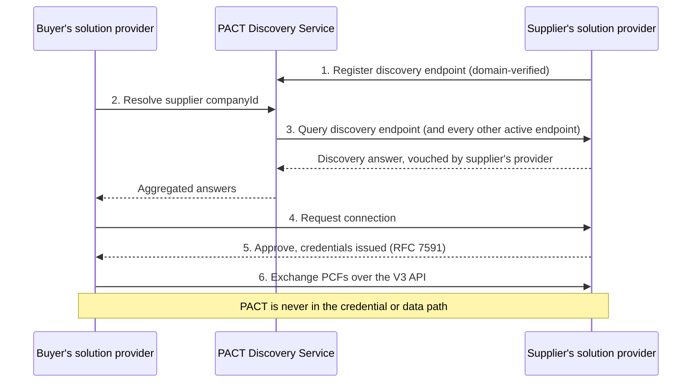

# PACT Identity Management Addendum — §5 Node Discoverability (Draft)

*Draft v0.2 — 14 October 2026. Normative text for the Node Discoverability section of the PACT Identity Management addendum to [DATA-EXCHANGE-PROTOCOL] V3. Builds on §3 (Identity Model) and §4 (Registration). Implements the decisions of the Technology Working Group session of **30 September 2026**: PACT operates a **central discovery service** that fans a query out to the discovery endpoints of registered Solution Providers, and the service is **private** — only registered Solution Providers may query it (see the addendum outline, §12.4). Editorial conventions follow the base specification: the key words MUST, MUST NOT, SHOULD, SHOULD NOT, MAY, REQUIRED, and OPTIONAL are to be interpreted as in [RFC2119]/[RFC8174] when, and only when, in all capitals.*

> **Status of this section.** Working draft for Technology Working Group review.
>
> **Changes in v0.2 (following the 30 September WG session).**
> - The two options of v0.1 are gone. **Central fan-out is the design** (W5) and the service is **private** (W6). Both options and the reasoning behind the choice are recorded in the decision log (§12.4), not here.
> - A Solution Provider implements **one** discovery endpoint, called by the PACT discovery service rather than by every other provider.
> - Discoverability is **opt-in, held and managed by the provider** (W7); by registering, a provider **vouches** for the customers that opted in (W8).
> - New §5.9 on **version changes to the service**, the item the WG asked for on 30 September (W10).
> - **Two decisions remain open** and are presented side by side: how a provider authenticates **to** the service (§5.5), and how a provider's endpoint authenticates calls **from** it (§5.6).

---

## 5. Node Discoverability

### 5.1 Introduction

Discovery answers one question for a party that wants to exchange PCF data with an organisation it has not exchanged with before:

> *Given one of this organisation's `companyIds`, which Node(s) can I send a connection request to, and who vouches for that answer?*

The target case is **cross-platform**: the two parties are served by different Solution Providers and do not know each other's endpoints. **Discovery within a provider's own platform is out of scope** — a provider already knows its own customers and handles that itself.

Discovery never grants access. A discovery answer lets a party *request* a connection; whether the connection is made is decided by the target (§6).

### 5.2 Why a directory rather than DNS

*Non-normative rationale, recorded at the request of the WG.*

DNS was considered: supplier domains are often known already, and a DNS record could point at a PACT endpoint. The directory was chosen because:

1. **PCF exchange is keyed on `companyIds`, not domains.** The domain a buyer knows, typically from a contact's email address, often says nothing about where the supplier's PCF tooling lives.
2. **Most suppliers are hosted by a Solution Provider.** A DNS design needs every supplier's IT team to publish and maintain records. With a provider-level directory, the provider publishes once for all its customers.
3. **DNS offers no opt-in short of "public", and no gate.** A record is visible to everyone and cannot be withheld from unknown callers; conformance-gated listing (§4.3) and suspension (§4.4.2) have no DNS equivalent.
4. **DNS would publish each supplier's choice of provider to the world**, which is precisely the exposure the private model (§5.5) avoids.

A domain-keyed lookup remains possible as a *complement* in a later version.

### 5.3 Architecture

```
┌──────────────────────┐   1. resolve(companyId)    ┌──────────────────────────────┐
│ Requesting Solution  │ ─────────────────────────► │ PACT Discovery Service        │
│ Provider (on behalf  │ ◄───────────────────────── │ · registry of SP endpoints §4 │
│ of its customer)     │   4. aggregated answers    │ · fan-out, retains nothing    │
└──────────────────────┘                            └───────┬───────┬───────┬──────┘
                                                            │ 2. query each registered
                                                            ▼       ▼       ▼
                                                   ┌────────────┐ ┌─────┐ ┌─────┐
                                                   │ SP-S disc. │ │SP-X │ │SP-Y │
                                                   │ endpoint   │ │ 404 │ │ 404 │
                                                   └─────┬──────┘ └─────┘ └─────┘
                                                         │ 3. match: node metadata
                                                         ▼
                                              ┌──────────────────────┐
┌──────────────────────┐  5. GET $base-url$/.well-known/openid-configuration
│ Requester  ─────────────────────────────────►│ Target Node          │
└──────────────────────┘                       └──────────────────────┘
```

1. PACT MUST operate a single **PACT Discovery Service**, which holds the registry of Solution Provider discovery endpoints (§4) and performs the fan-out.
2. A Solution Provider MUST implement exactly one **discovery endpoint**, which answers for the Entities it serves (§5.7).
3. The Discovery Service MUST NOT hold, index or build a register of the Entities that providers answer for, and MUST NOT store, cache or log query identifiers or answers beyond what is needed to serve the request and to operate the service securely.
4. Neither the Discovery Service nor any provider's discovery endpoint is in the credential or data path. Once a connection exists (§6), exchange MUST NOT depend on either being available.

### 5.4 Resolution procedure

1. A requester resolves an identifier by sending **one** query to the Discovery Service (§10.2), carrying a single `companyIds` value in canonical form (§3.4).
2. The Discovery Service MUST query every registered discovery endpoint whose listing status is `active`, and MUST NOT query a suspended or withdrawn listing.
3. The Discovery Service SHOULD query endpoints in parallel and SHOULD apply a per-endpoint timeout; an endpoint that does not answer in time is treated as returning no match, and the response MUST say so rather than omitting it silently.
4. The Discovery Service MUST return every positive answer it received, each labelled with the provider that gave it. An Entity MAY be served by more than one provider, so a requester MUST NOT assume at most one answer.
5. Where answers conflict — two unrelated providers claiming the same identifier with different Nodes — the requester MUST NOT silently discard or merge them, SHOULD present them with the vouching provider, and SHOULD report a suspected false answer to PACT (§4.4.2).
6. For each Node it intends to contact, the requester reads `token_endpoint` and `registration_endpoint` from that Node's own `$base-url$/.well-known/openid-configuration`, never from the discovery answer (§4.5).

*Editor's note.* One identifier per query. Batch queries are left out of this version to keep the interface small; the WG can add them once traffic patterns are known.

### 5.5 Access to the Discovery Service — private (W6)

1. The Discovery Service MUST accept queries **only from registered Solution Providers** (including an SP-of-one, §4.3.1). It MUST NOT offer anonymous or public lookup in this version.
2. A provider queries on behalf of its own customers; the Discovery Service MUST NOT require the identity of the customer on whose behalf a query is made, and a provider SHOULD NOT supply it.
3. Opening the service to a wider set of callers is a future change, subject to §5.9: a public read tier would return a reduced answer and is not defined here.

#### Open decision 1 — how a provider authenticates to the service

*The WG has not settled this. Both options are drafted; the choice affects §10 only.*

| | **1a — Credentials issued at registration** | **1b — Signed requests** |
|---|---|---|
| Mechanism | The service issues OAuth 2.0 client credentials when the provider is registered; the provider presents a bearer token on each query | The provider signs each query (HTTP Message Signatures [RFC9421]) with a key published at a `jwks_uri` under a domain verified in §4.3.3 |
| Provider effort | Store a secret, fetch a token — the same pattern providers already implement for the base specification | Key pair, JWKS publication, signing |
| Consistency with what exists | Matches the token route the PACT identity management service already serves (§10.5) | New infrastructure, but no shared secret to leak and reusable for §6 |
| Revocation | Revoke the client at suspension | Remove the listing; keys stay valid until the listing is checked |

### 5.6 Calls to a provider's discovery endpoint

1. A provider's discovery endpoint MUST answer queries from the PACT Discovery Service, and MUST authenticate that caller.
2. It MUST NOT accept unauthenticated queries from any source.

#### Open decision 2 — how the endpoint authenticates the service, and whether direct calls are allowed

| | **2a — Service only** | **2b — Service, plus direct provider-to-provider as fallback** |
|---|---|---|
| Who may call | The PACT Discovery Service and nobody else | The service, and any registered provider calling directly |
| Provider effort | One caller to authenticate; simplest to build and to conformance-test | Must authenticate many callers and check each is registered |
| Availability | Discovery is unavailable while the service is down; established connections are unaffected (§5.3, requirement 4) | A provider can fall back to querying endpoints directly from the registry listing |
| Exposure | Every queried provider sees the identifier; central fan-out can hide the requesting provider's identity | Every queried provider sees both the identifier and the authenticated requesting provider |

*Editor's note.* The two open decisions interact: 1b and 2b share one signing mechanism, while 1a and 2a together are the smallest thing a provider has to build. The WG may find them easier to decide as a pair.

### 5.7 Discovery answer

A positive answer describes one Entity and the Node(s) through which it can be contacted.

| Field | Requirement | Notes |
|---|---|---|
| `companyIds` | REQUIRED | The identifiers the provider publishes for the Entity, in canonical form (§3.4). MUST include the value queried. |
| `legalName` | OPTIONAL | As known to the provider. |
| `vouchedBy` | REQUIRED | The registered provider answering, and therefore vouching (§3.5, §4.5). |
| `assurance.level` | OPTIONAL | One of the levels of §3.5.1, where the provider publishes one. Absence means the provider's vouching alone, and MUST NOT be read as a negative statement. |
| `assurance.evidence[]` | CONDITIONAL | REQUIRED where a level is published: per method (`email`, `domain`, `lei-status`, `vc`), the time it was last confirmed, and the verified domain, LEI or credential profile (§3.5.2). |
| `nodes[].nodeId` | REQUIRED | Stable within the provider. |
| `nodes[].baseUrl` | REQUIRED | HTTPS `$base-url$` of the host system. |
| `nodes[].connectionEndpoint` | CONDITIONAL | REQUIRED where the Node is Credential-Exchange-capable (§6). |
| `nodes[].conformantVersions` | REQUIRED | Base-specification versions, from the PACT Conformance Service. MAY be empty. |
| `nodes[].provisional` | REQUIRED | `true` for a demo on-ramp Node (§4.5). |

1. A discovery answer MUST NOT include `token_endpoint`, `registration_endpoint`, contact details, or anything about the Entity's commercial relationships.
2. A provider MUST answer only for Entities it serves and that have opted in (§5.8).

*Example (non-normative):*

```json
{
  "companyIds": ["urn:lei:894500ABCDEF12345678", "urn:pfi:sp-example.com:customer:10442"],
  "legalName": "Example Supplier Ltd",
  "vouchedBy": "urn:pact:discovery-service:7d0c6b8e-2f1a-4b8e-9a51-0c3e1d5a9f10",
  "assurance": {
    "level": "domain-verified",
    "evidence": [
      { "method": "domain", "domain": "example-supplier.co.uk", "verifiedAt": "2026-07-02T09:14:00Z" }
    ]
  },
  "nodes": [
    {
      "nodeId": "node-10442-eu",
      "baseUrl": "https://pact.sp-example.com/tenants/10442",
      "connectionEndpoint": "https://pact.sp-example.com/tenants/10442/3/connections",
      "conformantVersions": ["3.0"],
      "provisional": false
    }
  ]
}
```

### 5.8 Visibility (W7)

1. An Entity is discoverable only where it has **opted in**. The opt-in is held and managed by the Solution Provider that serves it; how the provider collects and records it is not specified.
2. A provider MUST return the same "no match" result for an identifier it does not serve and one it serves but that has not opted in, so that absence reveals nothing.
3. An Entity MUST be able to withdraw its opt-in through its provider, and the provider MUST stop publishing it once the withdrawal is processed.
4. Search or browse by name is not part of this version; discovery is by identifier only.
5. Being discoverable is never being connected: every connection requires the target's approval (§6).

### 5.9 Availability, caching and version changes (W10)

1. A requester MAY cache answers according to their HTTP caching headers, and SHOULD resolve again immediately before sending a connection request (§6).
2. The Discovery Service and the discovery endpoint interface are **versioned**. Every response MUST carry the interface version it was served under.
3. PACT MUST announce a change that breaks compatibility with the current interface version **before** it takes effect, and MUST allow a transition period in which both versions are served. The length of that period and the channel used to announce it are operational and belong in an annex rather than here.
4. A provider MUST NOT be removed from the registry solely for not having adopted a new interface version before the announced transition period has ended (§4.3.4).
5. Non-breaking changes — new optional fields, new error codes — MAY be made without a transition period, and a provider MUST ignore fields it does not recognise.

*Editor's note.* The WG asked on 30 September for notification of registry and version changes. This version fixes the **policy** — versioned interface, announcement before breaking change, transition period, forward-compatible parsing — and leaves the **mechanism** (a change feed, subscriptions, or a mailing list) to §10 and to operations.

### 5.10 Summary figure

*Non-normative. The detailed sequence, including registration and credential exchange, is in the flow document.*



---

## Open items carried from this section

- **Open decision 1** — how a provider authenticates to the Discovery Service (§5.5).
- **Open decision 2** — how a provider's endpoint authenticates the service, and whether direct provider-to-provider queries are allowed as a fallback (§5.6).
- Accepted identifier schemes (§3.4) — **open pending the Taiwan UBN proof of concept on 28 October**; the mechanics of naming and matching are specified, the list is not.
- Transition period length and announcement channel for version changes (§5.9).
- Batch queries (§5.4).

---

### References used in this section

- [DATA-EXCHANGE-PROTOCOL] — Technical Specifications for PCF Data Exchange, V3.0.3.
- [RFC2119], [RFC8174] — requirement-level keywords.
- [RFC6749] — The OAuth 2.0 Authorization Framework.
- [RFC8414] — OAuth 2.0 Authorization Server Metadata.
- [RFC9110] — HTTP Semantics.
- [RFC9111] — HTTP Caching.
- [RFC9421] — HTTP Message Signatures.
